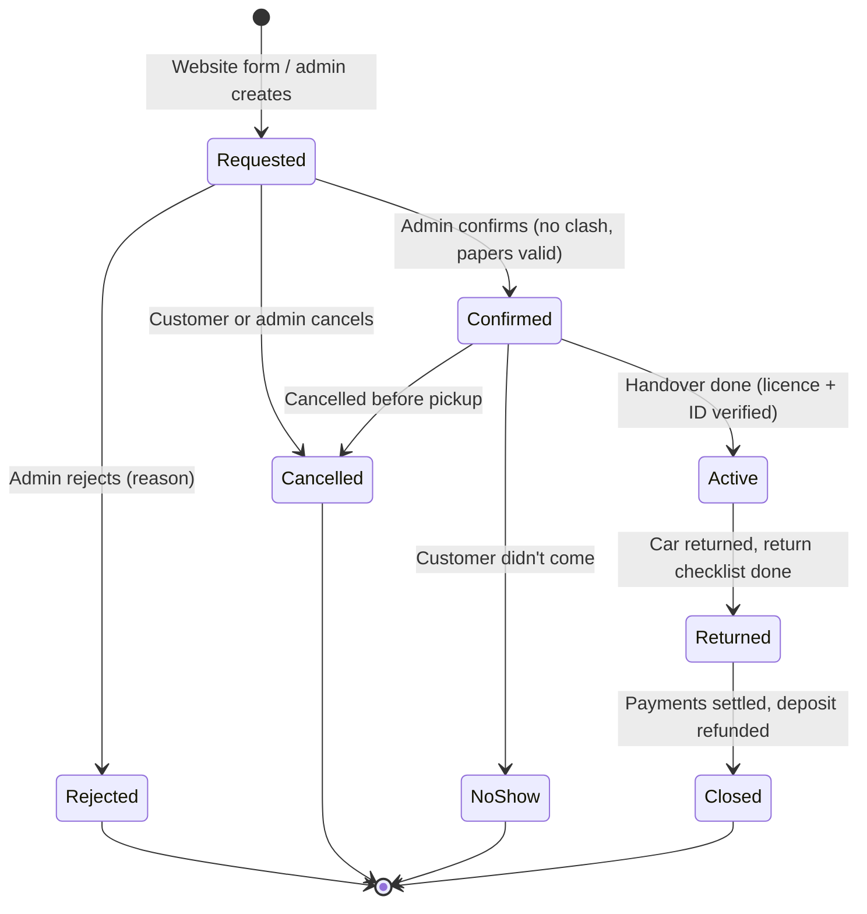

# KSR Self Drive Cars — Product Requirements Document

| | |
|---|---|
| **Product** | KSR Self Drive Cars: customer website, booking flow and admin module |
| **Live site** | https://ksr-self-drive-cars.lovable.app |
| **Design reference** | KSR Self Drive Cars design canvas (desktop site, mobile home, mobile booking) |
| **Version** | 1.0 — draft for review |
| **Date** | 11 October 2026 |
| **Owner** | [Owner name] |
| **Reviewers** | [Business owner], [Developer], [Legal/CA adviser for Section 10] |

Priority key used throughout: **P0** = needed for the first release (MVP), **P1** = second release, **P2** = later.

---

## Contents

1. Overview
2. Users and roles
3. Current state and gaps
4. Scope and release plan
5. Customer website
6. Admin module
7. Booking lifecycle
8. Data model
9. Technical architecture
10. Privacy, security and compliance
11. Notifications
12. Non-functional requirements
13. Analytics
14. Acceptance criteria
15. Open questions
16. Appendices

---

## 1. Overview

### 1.1 Summary

KSR Self Drive Cars rents 11 self-drive cars on two simple packages, 12 hours and 24 hours, starting at ₹1,300. The current website shows the fleet and opens a booking form, but the business has no back office: there is no place to see and confirm booking requests, no way to stop two people booking the same car for the same time, no safe way to update car photos and prices, and nowhere to keep customer ID documents or vehicle papers.

This PRD covers three connected parts:

1. **Customer website** — the public pages: hero, fleet with 12 hr / 24 hr pricing, and "How it works".
2. **Booking flow** — a request form that captures the car, package, pickup date and time, and the customer's verification details, with consent.
3. **Admin module** — a private, login-protected area where the owner and staff manage bookings, the fleet, prices, customers, handovers, payments and **documents** (customer KYC, booking paperwork and vehicle papers), with an audit trail.

### 1.2 Problems to solve

| # | Problem | Who feels it |
|---|---|---|
| P1 | Booking requests arrive without a pickup date or time, so every request needs a call just to find out when the customer wants the car. | Owner, customers |
| P2 | There is no list of requests and no status, so requests can be missed or double-booked. | Owner |
| P3 | Customer documents (licence, ID) and vehicle papers (RC, insurance, PUC) live on phones and in paper files; they are hard to find and easy to lose, and expiry dates are not tracked. | Owner, staff |
| P4 | Car photos, prices and availability can only be changed by editing the website itself. | Owner |
| P5 | The form collects a full Aadhaar number with no consent notice, which creates legal and security risk (Section 10). | Business |

### 1.3 Goals and success measures

| Goal | Measure | Suggested target |
|---|---|---|
| Every booking request is complete and actionable | Requests with car, package, pickup date/time, name, phone and DL number | 100% |
| Confirm requests quickly | Median time from request to Confirmed, during business hours | Under 30 minutes [owner to set] |
| No double bookings | Confirmed bookings overlapping on the same car | 0 |
| Never rent a car with expired papers | Bookings started on a car with expired insurance/PUC/permit | 0 |
| Documents are safe and findable | KYC document views that are logged; time to find a customer's licence | 100% logged; under 30 seconds |
| More bookings from the site | Booking form submissions ÷ fleet page visitors | Track baseline, then improve |

### 1.4 Not in scope for the first release

Online payment, customer accounts and login, multiple branches, dynamic or seasonal pricing, native mobile apps, GPS tracking of cars, and automated SMS/WhatsApp messaging. Several of these appear in later phases (Section 4).

---

## 2. Users and roles

### 2.1 Personas

| Persona | Description | Main jobs |
|---|---|---|
| **Customer** | Anyone visiting the site, usually on a phone, wanting a car for a few hours or a day. | Compare cars and prices, send a booking request, call the business. |
| **Owner** | Runs KSR. Full control. | Confirm bookings, set prices, manage fleet and staff, see revenue, keep documents. |
| **Manager** | Trusted staff who runs daily operations. | Confirm and edit bookings, manage customers and documents, record payments. |
| **Staff** | Handles handover and return at the counter or delivery point, mostly on a phone. | See today's pickups/returns, check documents, record odometer, fuel and photos, upload documents. |

### 2.2 Permission matrix (admin module)

| Capability | Owner | Manager | Staff |
|---|---|---|---|
| View dashboard | Yes | Yes | Today only |
| View / search bookings | All | All | Today ± 1 day |
| Create, confirm, edit, cancel bookings | Yes | Yes | No |
| Record handover and return | Yes | Yes | Yes |
| Add / edit cars, photos, prices | Yes | Yes | No |
| Put a car in maintenance | Yes | Yes | No |
| View customers | Yes | Yes | Only customers with a booking today |
| Block / unblock a customer | Yes | Yes | No |
| Upload documents | Yes | Yes | Yes |
| View / download KYC documents | Yes | Yes | View only, for today's bookings; no download |
| Verify / reject a document | Yes | Yes | Yes (at handover) |
| Delete a document | Yes | No | No |
| Record payments and refunds | Yes | Yes | Record only, no refunds |
| Reports and CSV export | Yes | Yes (no export of KYC data) | No |
| Settings, staff accounts, roles | Yes | No | No |
| Audit log | Yes | No | No |

---

## 3. Current state and gaps

What is live today (11 October 2026): a single landing page with logo, hero ("Your car, your schedule, your price."), three benefits (Flexible hours, Well maintained, Quick handover), and a fleet grid of 11 cars with photos, badges, specs and 12 hr / 24 hr prices. "Book Now" opens a modal titled "Book [car]" with a 12 hrs / 24 hrs toggle and four required fields: full name, phone number (10 digits), Aadhaar number (12 digits) and driving licence number, plus a "Confirm Booking" button.

| # | Gap found | Impact | Fixed by |
|---|---|---|---|
| G1 | Each public car card shows an **"Upload photo"** control. | Visitors see an admin action; risk of unwanted uploads; looks unfinished. | WEB-08, FLT-05 |
| G2 | Booking modal has **no pickup date or time**. | Every request needs a follow-up call; return time can't be calculated; availability can't be checked. | BK-03, BK-04 |
| G3 | Modal asks for the **full 12-digit Aadhaar number** with no consent notice. | Conflicts with UIDAI guidance for private entities; high-value data to store and protect. | BK-07, Section 10 |
| G4 | "Call to Book" links to a **placeholder number** (+91 00000 00000). | Lost calls and leads. | SET-01 |
| G5 | No admin area: requests can't be listed, confirmed or tracked. | Missed and double bookings. | Section 6 |
| G6 | No availability check. | Two customers can request and be promised the same car and time. | BK-10, BKA-07 |
| G7 | No privacy notice, terms or cancellation policy. | Customers don't know how data is used; disputes. | WEB-10, BK-08 |
| G8 | Car listed as "Victorious CNG"; Maruti's model is spelled "Victoris". | Looks careless; hurts search. | FLT-02 (owner edits name) |

---

## 4. Scope and release plan

| Release | Contents | Done when |
|---|---|---|
| **Release 1 — MVP (P0)** | Fix G1–G8. Booking form with date/time, consent and server-side storage. Admin login with roles. Bookings list, detail and status changes. Fleet management (cars, photos, prices, active/inactive). Customers list. **Document upload, view, verify and expiry for customers, bookings and cars.** Settings (phone, address, hours, policies). Email alert to admin for each new request. Basic audit log. | Owner runs a full week of bookings only through the admin module. |
| **Release 2 (P1)** | Availability blocking with maintenance windows, calendar view, handover and return checklists with photos and signature, payments and deposits ledger, expiry reminders, secure link for customers to upload documents, WhatsApp message templates, reports and CSV export. | Every pickup and return is recorded with photos and fuel/odometer. |
| **Release 3 (P2)** | Online advance payment (UPI/card via a payment gateway), automated WhatsApp/SMS, DigiLocker-based licence and ID verification through an approved partner, customer booking lookup, multi-day pricing, coupons, multiple pickup locations. | Customers can book and pay without a call. |

---

## 5. Customer website

The design canvas is the visual reference. Requirements below describe behaviour.

### 5.1 Global

| ID | Requirement | Priority |
|---|---|---|
| WEB-01 | Pages work from 320 px to 1920 px wide; mobile is the primary layout. | P0 |
| WEB-02 | Header: logo, links to Fleet, How it works, Book, and a "Call to book" button using the phone number from Settings. On mobile, a sticky bottom bar shows "Call" and "Book a car". | P0 |
| WEB-03 | Footer: business name, phone, pickup address, opening hours (all from Settings), links to Privacy notice, Terms and Cancellation policy, © year. | P0 |
| WEB-04 | SEO: unique title and meta description; Open Graph image; `AutoRental` structured data (name, phone, address, hours, price range); sitemap and robots.txt. | P0 |
| WEB-05 | Performance: car photos served as responsive WebP/AVIF with width/height set; lazy-load below the fold; Largest Contentful Paint under 2.5 s on a mid-range phone on 4G. | P0 |
| WEB-06 | Accessibility: WCAG 2.1 AA — keyboard reachable, visible focus, labelled form fields, 4.5:1 text contrast, touch targets at least 44 px. | P0 |
| WEB-07 | All content that changes (cars, prices, badges, photos, phone, address, hours, policies) comes from the database, not hard-coded. | P0 |
| WEB-08 | No admin controls (such as "Upload photo") appear on public pages. | P0 |
| WEB-09 | Optional WhatsApp button (shown only if a WhatsApp number is set) that opens a chat with a pre-filled message. | P1 |
| WEB-10 | Static pages: Privacy notice, Terms of rental, Cancellation policy, editable from Settings. | P0 |

### 5.2 Home and hero

| ID | Requirement | Priority |
|---|---|---|
| HOM-01 | Hero shows the headline, a one-line description, "Browse the fleet" and "Call to book". | P0 |
| HOM-02 | "From ₹X" is computed from the lowest active 12 hr price, so it updates when prices change. | P0 |
| HOM-03 | Starting prices by category (Hatchbacks, SUVs & crossovers, 6–7 seaters) are computed from active cars; clicking one scrolls to the fleet with that filter applied. | P1 |
| HOM-04 | Benefits strip: Flexible hours, Well maintained, Quick handover. | P0 |
| HOM-05 | "How it works" in three steps: pick a car and package; call or send a request; show your licence and take the keys. | P0 |

### 5.3 Fleet

| ID | Requirement | Priority |
|---|---|---|
| FLE-01 | Grid of all **active** cars in the admin-set order. Inactive cars are hidden. | P0 |
| FLE-02 | Each card: main photo, badge (if set), name, body type, seats, fuel, transmission, 12 hr price, 24 hr price, "Book this car". | P0 |
| FLE-03 | "Show prices for 12 hrs / 24 hrs" toggle that makes the chosen package the large price on every card. | P1 |
| FLE-04 | Filters: All, Hatchbacks, SUVs & crossovers, 6–7 seaters, CNG, with counts; "Showing X of Y cars" is announced to screen readers. | P1 |
| FLE-05 | Cars in maintenance on the selected date show "Not available on this date" (once a date is chosen in the booking form). | P1 |
| FLE-06 | Optional car detail page `/cars/[slug]` with photo gallery, specs and booking button, for SEO and sharing. | P2 |

### 5.4 Booking flow

Opening: "Book this car" opens the booking form (modal on desktop, full-screen sheet on mobile) with that car selected.

**Form fields**

| Field | Type | Required | Validation | Stored as |
|---|---|---|---|---|
| Car | Selector (pre-filled) | Yes | Must be an active car | `bookings.car_id` |
| Package | 12 hrs / 24 hrs toggle showing each price | Yes | — | `bookings.package`, price snapshot |
| Pickup date | Date picker | Yes | Today or later; within the booking window (Settings, e.g. next 60 days) | `bookings.pickup_at` |
| Pickup time | Time picker in 30-minute steps | Yes | Within opening hours; at least the minimum lead time from now (Settings) | `bookings.pickup_at` |
| Return by | Calculated, read-only | — | Pickup + 12 or 24 hours | `bookings.return_due_at` |
| Full name | Text | Yes | 2–80 characters, letters, spaces, `.` `'` `-` | `customers.full_name` |
| Mobile number | Tel | Yes | Indian mobile: 10 digits starting 6–9; `+91` and spaces stripped | `customers.phone` (E.164) |
| Driving licence number | Text | Yes | Format in Appendix A; auto-uppercased; spaces/hyphens removed | `customers.dl_number` |
| Aadhaar | See Section 10.2 | See 10.2 | Full 12-digit number is **not** collected online | `customers.aadhaar_last4` only |
| Email | Email | No | Valid email | `customers.email` |
| Consent | Checkbox, unticked by default | Yes | Must be ticked | `consents` row with notice version and time |
| Honeypot | Hidden field | — | Must be empty | Not stored |

**Behaviour**

| ID | Requirement | Priority |
|---|---|---|
| BK-01 | Form shows a live summary: car, package, pickup, return by, price, "Fuel as per policy". | P0 |
| BK-02 | Switching package updates the price and return time instantly. | P0 |
| BK-03 | Pickup date and time are required. | P0 |
| BK-04 | Return time is calculated and shown before submitting. | P0 |
| BK-05 | Inline validation on blur; errors say what to fix, for example "Enter a 10-digit mobile number starting with 6, 7, 8 or 9." | P0 |
| BK-06 | All validation is repeated on the server; the client is never trusted. | P0 |
| BK-07 | The full Aadhaar number is not requested. Aadhaar handling follows Section 10.2. | P0 |
| BK-08 | A short consent notice sits above the submit button with a link to the full Privacy notice (text in Appendix B). | P0 |
| BK-09 | On submit, the server finds or creates the customer by mobile number, creates the booking with status **Requested**, stores the price shown to the customer, and returns a booking code (format `KSR-YYMMDD-NNN`). | P0 |
| BK-10 | Before saving, the server checks the car against Confirmed/Active bookings and maintenance windows (plus the turnaround buffer from Settings). If it clashes, show: "This car is booked at that time. Try another time or another car," and suggest up to 3 available cars of the same category. | P1 (P0 = warn the admin instead) |
| BK-11 | Rate limiting: at most 5 submissions per mobile number and 20 per IP address per hour; extra attempts get "Too many requests. Please call us." | P0 |
| BK-12 | Confirmation screen: booking code, summary, "We'll call you to confirm," what to bring (original driving licence and Aadhaar for verification at pickup), "Call us" and "WhatsApp us" buttons. | P0 |
| BK-13 | If the customer is on the blocklist, the request is still accepted but flagged for the admin; the customer sees the normal confirmation. | P1 |
| BK-14 | If the licence expiry (when known from a previous booking) is before the return time, flag the booking for the admin. | P1 |
| BK-15 | Optional OTP check of the mobile number before submitting (needs an SMS provider; see Section 11). | P2 |
| BK-16 | Submit button is disabled while sending and shows "Sending…"; network failure shows "Couldn't send your request. Check your connection and try again," keeping everything the customer typed. | P0 |

**Customer-facing messages**

| Situation | Message |
|---|---|
| Missing pickup date or time | "Choose a pickup date and time." |
| Pickup outside hours | "We hand over cars between [open] and [close]. Choose a time in that window." |
| Too soon | "Bookings need at least [N] hours' notice. For an earlier pickup, call us." |
| Consent not ticked | "Tick the box to agree to how we use your details for this booking." |
| Car clash | "This car is booked at that time. Try another time or another car." |
| Success | "Request sent. Your booking code is KSR-…. We'll call you on [number] to confirm." |

### 5.5 Booking lookup (P2)

A customer enters booking code + mobile number to see status (Requested, Confirmed, Cancelled) and the pickup details. No personal documents are shown.

---

## 6. Admin module

### 6.1 Access and security

| ID | Requirement | Priority |
|---|---|---|
| ADM-01 | Admin lives at `/admin`, separate from public pages, and is not linked from the public site. `/admin` pages send `noindex`. | P0 |
| ADM-02 | Login with email and password. Accounts are created only by the Owner (no public sign-up). | P0 |
| ADM-03 | Two-step verification (authenticator app) is required for Owner and Manager, optional for Staff. | P0 for Owner, P1 for others |
| ADM-04 | Roles (Owner, Manager, Staff) are stored in a separate `user_roles` table and enforced in the database with row-level security, not only in the UI. | P0 |
| ADM-05 | Sessions expire after 12 hours, or 30 minutes of inactivity on screens showing documents. | P0 |
| ADM-06 | 5 failed logins lock the account for 15 minutes; the Owner gets an email. | P1 |
| ADM-07 | Password reset by email link. Owner can deactivate a staff account instantly, ending its sessions. | P0 |
| ADM-08 | The admin works well on a phone, because staff use it at handover. | P0 |

### 6.2 Screens

| Route | Screen | Roles |
|---|---|---|
| `/admin/login` | Login, 2-step code, reset password | All |
| `/admin` | Dashboard | All (Staff sees today only) |
| `/admin/bookings` | Bookings list | All |
| `/admin/bookings/new` | Create booking (phone/walk-in) | Owner, Manager |
| `/admin/bookings/:code` | Booking detail: customer, car, status, documents, handover, payments, timeline | All (by role) |
| `/admin/calendar` | Fleet calendar (cars × days) | Owner, Manager (P1) |
| `/admin/fleet` | Cars list | Owner, Manager |
| `/admin/fleet/:id` | Car detail: info, photos, prices, papers, maintenance, booking history | Owner, Manager |
| `/admin/customers` | Customers list | Owner, Manager |
| `/admin/customers/:id` | Customer detail: details, documents, bookings, notes, blocklist | Owner, Manager |
| `/admin/documents` | Document centre: all documents, filters, expiry alerts | Owner, Manager |
| `/admin/payments` | Payments ledger | Owner, Manager (P1) |
| `/admin/reports` | Reports | Owner, Manager (P1) |
| `/admin/settings` | Business details, booking rules, policies, templates | Owner |
| `/admin/staff` | Staff accounts and roles | Owner |
| `/admin/audit` | Audit log | Owner |

### 6.3 Dashboard

| ID | Requirement | Priority |
|---|---|---|
| DSH-01 | **Needs action**: new Requested bookings (oldest first, with time waiting), bookings flagged (clash, blocked customer, licence expiry). | P0 |
| DSH-02 | **Today**: pickups and returns with time, car, customer, phone (tap to call), status. | P0 |
| DSH-03 | **Overdue**: Active bookings past their return time, with how late. | P0 |
| DSH-04 | **Fleet now**: count and list of cars Available, On trip, In maintenance, Inactive. | P0 |
| DSH-05 | **Document alerts**: vehicle papers expiring in 30 days or expired; customer documents waiting for verification. | P0 |
| DSH-06 | **This month**: bookings completed, revenue recorded, utilisation (hours rented ÷ hours available). | P1 |

### 6.4 Bookings

| ID | Requirement | Priority |
|---|---|---|
| BKA-01 | List with search (booking code, customer name, mobile, car registration) and filters (status, car, date range, source). Default sort: pickup time ascending for upcoming. | P0 |
| BKA-02 | Columns: code, status, pickup, return by, car, customer, mobile, package, amount, payment status, flags. | P0 |
| BKA-03 | Booking detail shows everything about one booking on one screen, with a timeline of status changes (who and when). | P0 |
| BKA-04 | Actions by status: Confirm, Reject (reason required), Cancel (reason required), Mark picked up (opens handover), Mark returned (opens return), Mark no-show, Close. Allowed transitions are in Section 7. | P0 |
| BKA-05 | Edit car, package, pickup time or price before pickup; changes are logged; price override needs a reason. | P0 |
| BKA-06 | Create a booking for phone, walk-in or WhatsApp customers with the same fields and checks as the website; source is recorded. | P0 |
| BKA-07 | Confirming a booking that clashes with another Confirmed/Active booking or a maintenance window is blocked, showing the clashing booking. | P0 |
| BKA-08 | One-tap "Call" and "WhatsApp" for the customer; WhatsApp opens with a template (confirmation, reminder, directions). | P0 (call), P1 (templates) |
| BKA-09 | Extend an Active booking (another 12 or 24 hours, or custom hours at the extra-hour rate) after an availability check. | P1 |
| BKA-10 | Late return: the system calculates late hours and suggests a charge from the late-fee rule in Settings; staff can adjust with a reason. | P1 |
| BKA-11 | Print or download a booking summary / rental agreement as PDF, pre-filled from the booking. | P1 |

### 6.5 Calendar (P1)

| ID | Requirement | Priority |
|---|---|---|
| CAL-01 | Grid with one row per car and time across days (day / week view); bookings appear as bars coloured by status; maintenance appears as hatched blocks. | P1 |
| CAL-02 | Tapping an empty slot starts a new booking for that car and time; tapping a bar opens the booking. | P1 |
| CAL-03 | Drag to reschedule is allowed only into free slots and asks for confirmation. | P2 |

### 6.6 Fleet

| ID | Requirement | Priority |
|---|---|---|
| FLT-01 | Cars list with photo, name, registration number, status, 12 hr and 24 hr prices, next booking, paper expiry warning. | P0 |
| FLT-02 | Add / edit a car: display name, brand, model, body type, seats, fuel, transmission, colour, year, registration number, badge (Premium, New model, Best value, 7 seater or custom), short description, display order. | P0 |
| FLT-03 | Prices: 12 hr and 24 hr prices per car. Price changes apply to new bookings only; existing bookings keep their stored price. Price history is kept. | P0 |
| FLT-04 | Status: Active (shown and bookable), Inactive (hidden), plus maintenance windows (shown but not bookable in that window). | P0 |
| FLT-05 | Photos: upload up to 8 per car (JPG, PNG, WebP, HEIC; max 10 MB each); images are resized and converted to WebP automatically; drag to reorder; choose the cover photo; alt text required. | P0 |
| FLT-06 | Maintenance windows: start, end, reason (service, repair, accident, other); clashing bookings are listed before saving. | P1 |
| FLT-07 | Vehicle papers live on the car page (Documents tab) using the document centre (Section 6.8). | P0 |
| FLT-08 | A car whose insurance, PUC or permit is expired cannot be confirmed for a booking; Owner can override with a reason (logged). | P0 |
| FLT-09 | Service log: date, odometer, work done, cost, garage, invoice document. | P1 |

### 6.7 Customers

| ID | Requirement | Priority |
|---|---|---|
| CUS-01 | One customer record per mobile number; website requests are matched to existing customers. | P0 |
| CUS-02 | List with search by name, mobile, licence number; shows number of bookings, last booking, verification status, blocklist flag. | P0 |
| CUS-03 | Customer detail: contact details, licence number and expiry, Aadhaar last 4 digits and verification status, documents, bookings, payments, notes. | P0 |
| CUS-04 | Blocklist with reason (for example unpaid damage); new requests from a blocked number are flagged. | P1 |
| CUS-05 | Merge two customer records (for example after a number change), keeping all bookings and documents. | P2 |
| CUS-06 | Data requests: export a customer's data, or erase it once the retention period has passed and nothing is pending (Section 10.4). | P1 |

### 6.8 Document centre

This is the core new capability: staff can save, find, verify and track every document the business needs, attached to the customer, booking or car it belongs to.

#### 6.8.1 Document types

| Category | Document type | Attached to | Expiry tracked | Who can view |
|---|---|---|---|---|
| Customer (KYC) | Driving licence — front | Customer | Yes | Owner, Manager; Staff for today's bookings |
| Customer (KYC) | Driving licence — back | Customer | — | Same as above |
| Customer (KYC) | Aadhaar — **masked copy only** | Customer | — | Same as above |
| Customer (KYC) | Other photo ID (passport, voter ID, PAN) | Customer | Optional | Same as above |
| Customer (KYC) | Photo of customer with licence at handover | Customer / booking | — | Same as above (P1) |
| Booking | Signed rental agreement | Booking | — | Owner, Manager, Staff |
| Booking | Pickup photos (car exterior, interior, odometer, fuel gauge) | Booking | — | Owner, Manager, Staff |
| Booking | Return photos | Booking | — | Owner, Manager, Staff |
| Booking | Damage photos and repair estimate | Booking | — | Owner, Manager |
| Booking | Payment receipt / UPI screenshot | Booking | — | Owner, Manager |
| Booking | Traffic challan / fine notice | Booking | — | Owner, Manager |
| Booking | Insurance claim or police report | Booking | — | Owner, Manager |
| Vehicle | Registration certificate (RC) | Car | — | Owner, Manager |
| Vehicle | Insurance policy | Car | Yes | Owner, Manager |
| Vehicle | PUC certificate | Car | Yes | Owner, Manager |
| Vehicle | Permit / rent-a-cab authorisation (as applicable) | Car | Yes | Owner, Manager |
| Vehicle | Fitness certificate (if applicable) | Car | Yes | Owner, Manager |
| Vehicle | Road tax receipt | Car | Optional | Owner, Manager |
| Vehicle | FASTag details | Car | — | Owner, Manager |
| Vehicle | Service invoices | Car | — | Owner, Manager |
| Business | GST registration, trade licence, business insurance, agreement templates | Business | Optional | Owner |

The list of types is editable in Settings (P1): add a type, choose what it attaches to, whether expiry is tracked, and who can view it.

#### 6.8.2 Requirements

| ID | Requirement | Priority |
|---|---|---|
| DOC-01 | Upload from any customer, booking or car page, or from the Document centre (choose what it belongs to first). | P0 |
| DOC-02 | On a phone, "Upload" offers the camera directly as well as the photo gallery and files. Multiple files at once. | P0 |
| DOC-03 | Allowed types: JPG, PNG, WebP, HEIC, PDF. Max 10 MB per file. Images over 2,500 px are resized before upload; HEIC is converted to JPG. | P0 |
| DOC-04 | Each document stores: type, what it belongs to, document number (masked where required), issue date, expiry date, notes, uploaded by, uploaded at, file size, file type, and a SHA-256 fingerprint to spot duplicates. | P0 |
| DOC-05 | Files are stored in a **private** storage bucket. Nothing is ever reachable by a public URL. Viewing uses a signed link that expires after 5 minutes. | P0 |
| DOC-06 | In-app viewer for images (zoom, rotate) and PDFs, so staff don't need to download. Download is a separate action, allowed by role (Section 2.2). | P0 |
| DOC-07 | Every view, download, upload, verification, replacement and deletion is written to the audit log with user, time, IP address and device. | P0 |
| DOC-08 | Verification: each KYC document has a status — Pending, Verified, Rejected (reason required), Expired. Verifying records who verified it, when, and how (original seen at counter, QR scan, online portal check). | P0 |
| DOC-09 | A booking can't move to Active (picked up) until the customer has a Verified driving licence that is valid past the return time, and identity has been verified (Section 10.2). Owner can override with a reason. | P0 |
| DOC-10 | **Aadhaar safeguard**: the uploader confirms that the Aadhaar image is masked (only last 4 digits visible). If an unmasked copy is uploaded by mistake, the tool lets staff cover the first 8 digits before saving (redaction tool, P1); until then staff must re-upload a masked copy. The original unmasked file is never stored. | P0 (confirm), P1 (redaction tool) |
| DOC-11 | Replace a document with a newer version (for example a renewed insurance policy). The old version is kept as history and is marked Superseded. | P0 |
| DOC-12 | Expiry tracking: documents with an expiry date show Valid, Expiring soon (within 30 days) or Expired. Expired vehicle papers block bookings (FLT-08). | P0 |
| DOC-13 | Reminders: email (and WhatsApp in P2) to Owner and Manager 30, 15, 7 and 1 day(s) before a vehicle document expires, and on the day it expires. | P1 |
| DOC-14 | Document centre list: filters by category, type, status, expiry window, car, customer, uploaded by, date; search by customer name, mobile, car registration, document number. | P0 |
| DOC-15 | Deletion: only the Owner can delete; deletion is soft (hidden, kept for 30 days, then permanently erased by a scheduled job) and needs a reason. Retention rules in Section 10.4 run the same way automatically. | P0 |
| DOC-16 | Customer self-upload link: staff send a one-time link (valid 24 hours) by WhatsApp/SMS; the customer uploads licence photos and a masked Aadhaar before pickup; files arrive as Pending for verification. | P1 |
| DOC-17 | Optional watermark on viewed and downloaded KYC images: "KSR Self Drive Cars — for rental verification only — [date]". | P2 |
| DOC-18 | Bulk download of all papers for one car as a ZIP (for example for an insurance claim), Owner only, logged. | P2 |

#### 6.8.3 Storage layout

| Bucket | Visibility | Path pattern | Contents |
|---|---|---|---|
| `car-photos` | Public (read-only) | `cars/{car_id}/{photo_id}.webp` | Fleet photos shown on the website |
| `documents` | Private | `customers/{customer_id}/{doc_type}/{document_id}.{ext}` | KYC documents |
| `documents` | Private | `bookings/{booking_id}/{doc_type}/{document_id}.{ext}` | Agreements, handover photos, receipts, fines |
| `documents` | Private | `vehicles/{car_id}/{doc_type}/{document_id}.{ext}` | RC, insurance, PUC, permits, invoices |
| `documents` | Private | `business/{doc_type}/{document_id}.{ext}` | Business papers |

File names in storage are random IDs; the original file name is kept only in the database.

### 6.9 Handover and return (P1)

| ID | Requirement | Priority |
|---|---|---|
| HND-01 | Pickup checklist on the phone: verify licence and identity (DOC-08/09), odometer reading, fuel level (Empty, ¼, ½, ¾, Full), photos of 4 sides, interior, odometer and fuel gauge, existing damage notes, accessories present (spare wheel, jack, documents in car), deposit collected. | P1 |
| HND-02 | Customer signs on the phone screen to accept the car's condition and the terms; the signature image is saved to the booking. | P1 |
| HND-03 | Return checklist: same readings and photos; the system shows km driven, fuel difference, late hours, and any new damage marked by staff. | P1 |
| HND-04 | Extra charges (late hours, fuel, damage, cleaning, challans) are added as line items with notes and optional photos; deposit refund amount is calculated. | P1 |
| HND-05 | Handover and return can be completed offline-tolerant: photos queue and upload when the connection returns. | P2 |

### 6.10 Payments and deposits (P1)

| ID | Requirement | Priority |
|---|---|---|
| PAY-01 | Record payments against a booking: amount, type (rent, deposit, extra charge, refund), method (cash, UPI, card, bank transfer), reference number, received by, time, optional receipt document. | P1 |
| PAY-02 | Booking shows total due, paid, balance, deposit held, deposit refunded; payment status updates automatically (Unpaid, Part paid, Paid, Refunded). | P1 |
| PAY-03 | Refunds need a reason; only Owner and Manager can record them. | P1 |
| PAY-04 | Online advance payment through a payment gateway (UPI and cards), with webhook confirmation and automatic receipt. | P2 |
| PAY-05 | GST invoice generation, if the business is GST-registered [to confirm]. | P2 |

### 6.11 Reports (P1)

| ID | Report | Contents |
|---|---|---|
| RPT-01 | Revenue | By day, week, month; by car; by package; by payment method. |
| RPT-02 | Utilisation | Hours rented ÷ hours available per car; idle cars. |
| RPT-03 | Bookings funnel | Requested → Confirmed → Completed; rejected/cancelled reasons; no-shows. |
| RPT-04 | Sources | Website, phone, walk-in, WhatsApp. |
| RPT-05 | Documents | Vehicle papers expiring in the next 60 days; customers with unverified documents. |
| RPT-06 | Export | CSV export of bookings and payments (no KYC files, no document numbers). |

### 6.12 Settings and staff

| ID | Requirement | Priority |
|---|---|---|
| SET-01 | Business details: name, phone, WhatsApp number, email, pickup address and map link, opening hours by day. These feed the website. | P0 |
| SET-02 | Booking rules: minimum lead time, how far ahead bookings are allowed, pickup time step, turnaround buffer between bookings, late-return grace period and hourly late fee, default security deposit, km limit per package and extra-km rate (if any), fuel policy text. | P0 |
| SET-03 | Policies: Privacy notice, Terms of rental, Cancellation policy (rich text, versioned; the version a customer agreed to is stored with their consent). | P0 |
| SET-04 | Message templates for WhatsApp/SMS/email with placeholders such as `{name}`, `{car}`, `{pickup}`, `{code}`. | P1 |
| SET-05 | Staff: invite by email, assign role, deactivate. | P0 |
| SET-06 | Document types and retention periods (Section 10.4). | P1 |
| SET-07 | Notification preferences: who gets new-request and expiry emails. | P0 |

### 6.13 Audit log

| ID | Requirement | Priority |
|---|---|---|
| AUD-01 | Record: logins and failed logins, booking status changes and edits, price changes, car changes, customer edits and blocks, every document action (upload, view, download, verify, replace, delete), settings changes, staff changes, data exports. | P0 |
| AUD-02 | Each entry: who, what, which record, before/after values for edits, time, IP address, device. | P0 |
| AUD-03 | Read-only, Owner-only, searchable by user, action, record and date; cannot be edited or deleted from the app. | P0 |
| AUD-04 | Kept for at least the longest document retention period. | P0 |

---

## 7. Booking lifecycle

| Status | Meaning | Set by | Holds the car? | Customer told |
|---|---|---|---|---|
| Requested | Form submitted, not yet checked | System | No (admin sees a clash warning) | Confirmation screen |
| Confirmed | Admin accepted; car reserved | Owner, Manager | Yes, pickup to return + buffer | Call / WhatsApp (P1 template) |
| Rejected | Not accepted (car unavailable, failed checks) | Owner, Manager | No | Call / WhatsApp with reason |
| Cancelled | Cancelled by customer or business | Owner, Manager | No | Call / WhatsApp |
| No-show | Customer didn't arrive within the grace period | Owner, Manager, Staff | Released | — |
| Active | Car handed over | Staff and above | Yes, until returned | — |
| Returned | Car back; charges being settled | Staff and above | No | Final amount |
| Closed | Everything settled | Owner, Manager | No | Receipt (P1) |

"Overdue" is not a status: it is shown whenever a booking is Active and the return time has passed.

---

## 8. Data model

All tables have `id` (UUID), `created_at` and `updated_at`. Times are stored in UTC and shown in India Standard Time. Money is stored as whole paise (integer) to avoid rounding errors.

### 8.1 `cars`

| Column | Type | Notes |
|---|---|---|
| slug | text, unique | For URLs, e.g. `kia-sonet` |
| display_name | text | e.g. "Kia Sonet" |
| brand, model, variant | text | |
| body_type | enum | hatchback, compact_suv, crossover, suv, micro_suv, mpv, premium_mpv |
| category | enum | hatch, suv, mpv (for filters) |
| seats | smallint | |
| fuel | enum | petrol, diesel, cng, electric |
| transmission | enum | manual, automatic |
| colour, year | text, smallint | |
| registration_number | text, unique | Admin only, never public |
| badge | text, nullable | Premium, New model, Best value, 7 seater, custom |
| price_12h_paise, price_24h_paise | integer | Current prices |
| status | enum | active, inactive |
| sort_order | integer | |
| cover_photo_id | UUID, nullable | → `car_photos` |

### 8.2 Other tables

| Table | Key columns |
|---|---|
| `car_photos` | car_id, storage_path, alt_text, sort_order, width, height |
| `car_price_history` | car_id, price_12h_paise, price_24h_paise, changed_by, changed_at |
| `maintenance_windows` | car_id, starts_at, ends_at, reason, notes, created_by |
| `customers` | full_name, phone (unique, E.164), email, dl_number, dl_expiry, aadhaar_last4 (char 4, nullable), identity_verified (bool), identity_method (enum: aadhaar_qr, aadhaar_original_seen, passport, voter_id, other, digilocker), identity_verified_by, identity_verified_at, blocked (bool), block_reason, notes |
| `bookings` | booking_code (unique), customer_id, car_id, package (12h/24h/custom), pickup_at, return_due_at, actual_pickup_at, actual_return_at, status, source (website/phone/walk_in/whatsapp), price_quoted_paise, extra_charges_paise, discount_paise, deposit_paise, total_paise, paid_paise, payment_status, flags (array: clash, blocked_customer, dl_expiry), cancel_reason, admin_notes, created_by (null for website), consent_id |
| `booking_events` | booking_id, from_status, to_status, actor_id, note, at |
| `handover_records` | booking_id, kind (pickup/return), odometer_km, fuel_level, checklist (JSON), damage_notes, signature_document_id, recorded_by, recorded_at |
| `booking_charges` | booking_id, kind (late, fuel, damage, cleaning, challan, other), amount_paise, note, document_id, added_by |
| `payments` | booking_id, amount_paise, type (rent/deposit/extra/refund), method (cash/upi/card/bank), reference, receipt_document_id, received_by, received_at |
| `documents` | owner_type (customer/booking/car/business), owner_id, doc_type, storage_path, original_filename, mime_type, size_bytes, sha256, doc_number_masked, issue_date, expiry_date, status (pending/verified/rejected/expired/superseded), verification_method, verified_by, verified_at, reject_reason, version, replaces_id, uploaded_by, uploaded_via (admin/customer_link), deleted_at, delete_reason, retain_until |
| `document_types` | key, label, owner_type, tracks_expiry, required_for_pickup, view_roles, retention_days |
| `upload_links` (P1) | customer_id, booking_id, token_hash, expires_at, used_at, created_by |
| `consents` | customer_id, booking_id, purpose, notice_version, granted_at, ip, user_agent, withdrawn_at |
| `user_roles` | user_id, role (owner/manager/staff) |
| `staff_profiles` | user_id, full_name, phone, active |
| `settings` | key, value (JSON), updated_by |
| `audit_logs` | actor_id, action, entity_type, entity_id, before (JSON), after (JSON), ip, user_agent, at |

### 8.3 Database rules

| Rule | How |
|---|---|
| No overlapping confirmed bookings on one car | Exclusion constraint on `(car_id, time range from pickup_at to return_due_at + buffer)` for status Confirmed or Active, plus a check against `maintenance_windows`. |
| One customer per mobile number | Unique index on `customers.phone`. |
| Booking code | `KSR-YYMMDD-NNN`, generated in the database, unique. |
| Price snapshot | `bookings.price_quoted_paise` is set at creation and never changes when car prices change. |
| Soft delete | `documents.deleted_at`; a scheduled job erases the file and row after 30 days. |

---

## 9. Technical architecture

### 9.1 Stack

| Layer | Choice | Notes |
|---|---|---|
| Front end | React + TypeScript + Vite + Tailwind (the current Lovable stack) | Public site and `/admin` in one app, admin code split into its own bundle. |
| Backend | Lovable Cloud / Supabase: Postgres, Auth, Storage, Edge Functions, scheduled jobs | Choose the Mumbai region where available, for speed and data location. |
| Email | Transactional email provider (e.g. Resend, Amazon SES) | New-request and expiry alerts. |
| WhatsApp / SMS (P2) | WhatsApp Business API provider or SMS gateway | SMS in India needs DLT template registration. |
| Payments (P2) | Indian payment gateway with UPI | Webhooks to confirm payments. |
| Analytics | Privacy-friendly analytics (e.g. Plausible) or GA4 with IP anonymisation | No personal data in events. |

### 9.2 Access control

| Rule | Detail |
|---|---|
| Public visitors | Can read only a `public_cars` view (no registration numbers, no internal notes) and public photo URLs. They cannot read any booking, customer or document data. |
| Booking submission | Goes through the `submit-booking` edge function, which validates, rate-limits and writes with server privileges. The browser never writes to tables directly. |
| Admin users | Row-level security on every table, using a `has_role(user_id, role)` database function over `user_roles`. Staff-scope rules (today's bookings only) are enforced in policies, not just hidden in the UI. |
| Storage | `documents` bucket is private; files are reachable only through short-lived signed URLs issued by an edge function after a role check, and every issue is logged. |
| Secrets | Service keys live only in edge function secrets, never in front-end code. |

### 9.3 Edge functions and jobs

| Name | Called by | Purpose | Priority |
|---|---|---|---|
| `submit-booking` | Public site | Validate, rate-limit, upsert customer, availability check, create booking and consent, email admin | P0 |
| `availability` | Public site | Return busy windows per car for a date (no personal data) | P1 |
| `document-upload-url` | Admin | Check role, create `documents` row (Pending), return signed upload URL | P0 |
| `document-view-url` | Admin | Check role and scope, write audit entry, return 5-minute signed URL | P0 |
| `create-upload-link` / `customer-upload` | Admin / customer | One-time customer upload link and upload endpoint | P1 |
| `expiry-reminders` | Daily schedule, 08:00 IST | Mark expired documents, send reminders | P1 (marking P0) |
| `retention-purge` | Daily schedule | Erase soft-deleted and past-retention documents, log each erasure | P0 |
| `notify` | Other functions | Send email / WhatsApp / SMS using templates | P0 (email) |

---

## 10. Privacy, security and compliance

> This section describes product safeguards, not legal advice. Have it reviewed by a lawyer or compliance adviser before launch.

### 10.1 Personal data the product handles

| Data | Why it's needed | Where it lives |
|---|---|---|
| Name, mobile, email | Contact, booking confirmation | `customers` |
| Driving licence number, expiry, licence images | Legal requirement to drive; verification | `customers`, private documents |
| Identity verification result, Aadhaar last 4 digits, masked Aadhaar image (optional) | Confirm the renter is who they say they are | `customers`, private documents |
| Booking times, car, handover photos, signature | Contract, damage and fine handling | `bookings`, private documents |
| Payments | Accounts | `payments` |

### 10.2 Aadhaar handling

**What UIDAI guidance says.** UIDAI's guidance for organisations that verify Aadhaar offline (OVSEs) says: verify only with the holder's explicit consent and for a stated lawful purpose; do not accept the Aadhaar number alone as proof of identity; do not refuse service to someone who can identify themselves another way; do not collect, use or store the Aadhaar number after verification; and if a copy must be kept, the number must be redacted/masked and irretrievable. See the UIDAI references in Appendix D.

**Product decision (proposed).**

| ID | Requirement | Priority |
|---|---|---|
| AAD-01 | Remove the "Aadhaar number (12 digits)" field from the website form. | P0 |
| AAD-02 | At pickup, staff verify the customer's Aadhaar (original card, e-Aadhaar, m-Aadhaar or PVC card) by scanning its secure QR code with UIDAI's official app, with the customer's consent, and record the result, method, staff member and time. | P0 |
| AAD-03 | Store only the last 4 digits for matching. If a copy is needed, store only a masked Aadhaar image (DOC-10). | P0 |
| AAD-04 | Accept other government photo ID (passport, voter ID) as an alternative identity proof. | P0 |
| AAD-05 | Later: verification through DigiLocker via an approved partner, so the customer shares verified licence and ID data digitally. | P2 |

### 10.3 Digital Personal Data Protection Act, 2023

The DPDP Rules, 2025 were notified on 13–14 November 2025 with a phased start; most operational duties (notice and consent, security safeguards, breach notification, data-principal rights) apply from about mid-May 2027. Building them in now avoids rework.

| ID | Requirement | Priority |
|---|---|---|
| DP-01 | Clear notice at the point of collection: what data, why, how long, and how to contact the business or complain (Appendix B). | P0 |
| DP-02 | Consent is a separate, unticked checkbox; the notice version and time are stored. | P0 |
| DP-03 | Collect only what is needed (data minimisation): no full Aadhaar number, no date of birth unless required, no address unless delivering the car. | P0 |
| DP-04 | Grievance contact (name/email/phone) on the Privacy notice; requests are logged and answered within the time the law sets. | P0 |
| DP-05 | Customer rights: access a copy of their data, correct it, and ask for erasure; erasure is blocked while a booking, payment, fine or claim is open, and the customer is told why. | P1 |
| DP-06 | Breach plan: who decides, how affected customers are told, and how the Data Protection Board is informed within the deadlines in the Rules. | P0 |
| DP-07 | Notice available in Telugu and Hindi as well as English. | P1 |

### 10.4 Retention

Periods below are starting proposals for the owner and adviser to confirm; each is a setting (SET-06).

| Data | Proposed retention | Reason | Then |
|---|---|---|---|
| Masked Aadhaar image | Until the booking closes + [30] days | Identity check is complete at pickup | Erased automatically |
| Driving licence images | [6] months after the last booking closes | Traffic challans and damage claims can arrive weeks or months later | Erased automatically |
| Handover/return photos, signature | [6] months after booking closes, longer if a claim or fine is open | Damage disputes | Erased automatically |
| Booking and payment records | As required for tax and accounts [confirm with CA] | Legal/accounting | Archived; personal fields minimised after [N] years |
| Vehicle papers | While the car is in the fleet + [1] year | Operations, insurance | Owner review |
| Audit logs | At least [1] year, and no shorter than the longest document retention | Security, accountability | Erased automatically |
| Unconfirmed / rejected requests | [90] days | No ongoing purpose | Erased automatically |

Any document linked to an open fine, claim or dispute is put on **hold** and skipped by the purge until the hold is removed.

### 10.5 Security controls

| Area | Control |
|---|---|
| Transport | HTTPS everywhere; HSTS. |
| Storage | Private bucket, encryption at rest (provider default), random file names, signed URLs valid for 5 minutes. |
| Access | Role-based, enforced in the database; 2-step login for Owner and Manager; least-privilege staff scope. |
| Logging | All document and data access logged (AUD-01). |
| Uploads | File-type check by content (not just extension), size limits, image re-encoding to strip hidden content and location metadata. |
| Abuse | Rate limiting, honeypot field, optional OTP (BK-15). |
| Backups | Daily database backups with point-in-time recovery where the plan supports it; restore tested every quarter. |
| Devices | Staff phones used for the admin must have a screen lock; documents are not saved to the phone gallery by the app. |

---

## 11. Notifications

| Event | Recipient | Channel | Priority |
|---|---|---|---|
| New booking request | Owner, Manager | Email (and push/WhatsApp in P2) | P0 |
| Booking flagged (clash, blocked customer, licence expiry) | Owner, Manager | Email | P1 |
| Booking confirmed | Customer | WhatsApp template from admin (one tap) → automated in P2 | P1 / P2 |
| Pickup reminder (e.g. 3 hours before) | Customer | WhatsApp/SMS | P2 |
| Return reminder (1 hour before) | Customer | WhatsApp/SMS | P2 |
| Overdue return | Owner, Manager, assigned Staff | Email / push | P1 |
| Vehicle document expiring / expired | Owner, Manager | Email | P1 |
| Customer uploaded documents via link | Owner, Manager | Email | P1 |
| Failed login lockout | Owner | Email | P1 |

---

## 12. Non-functional requirements

| Area | Requirement |
|---|---|
| Performance | Public pages: LCP under 2.5 s, CLS under 0.1 on a mid-range phone on 4G. Admin lists load under 1.5 s for up to 10,000 bookings. |
| Availability | 99.5% monthly for the public site and booking submission. |
| Browsers | Last 2 versions of Chrome, Safari (iOS), Samsung Internet, Edge, Firefox. |
| Accessibility | WCAG 2.1 AA for public site and admin. |
| Localisation | English first; Telugu and Hindi for public pages and notices in P1. Prices in ₹ with Indian digit grouping (₹1,00,000). Times in 12-hour IST. |
| Scalability | Designed for up to 50 cars and 5 staff without changes. |
| Maintainability | Business rules (hours, buffers, fees, retention) are settings, not code. |
| Data residency | Primary database and storage in an Indian region where available. |

---

## 13. Analytics

Events carry no names, phone numbers or document data.

| Event | Properties |
|---|---|
| `fleet_viewed` | — |
| `fleet_filter_used` | filter |
| `package_toggled` | package |
| `booking_opened` | car_slug |
| `booking_submitted` | car_slug, package, lead_time_hours |
| `booking_failed` | reason (validation, clash, rate_limit, network) |
| `call_clicked` | location (header, hero, sticky_bar, confirmation) |
| `whatsapp_clicked` | location |

---

## 14. Acceptance criteria

| # | Scenario | Given / When / Then |
|---|---|---|
| AC-01 | Complete request | Given a visitor on the fleet, when they choose Kia Sonet, 24 hrs, tomorrow 10:00, fill name, mobile, licence and tick consent, then a booking with status Requested and a KSR- code is created, the price stored is the 24 hr price shown, the return time is tomorrow+1 10:00, and the Owner gets an email. |
| AC-02 | Missing time | Given the form without a pickup time, when they submit, then nothing is saved and "Choose a pickup date and time." appears next to the field. |
| AC-03 | No full Aadhaar | Given the website form, then there is no field that accepts a 12-digit Aadhaar number, and the database has no column for a full Aadhaar number. |
| AC-04 | Clash blocked | Given XL6 CNG is Confirmed for Saturday 09:00–21:00, when a Manager tries to confirm another XL6 booking for Saturday 15:00, then confirmation is refused and the clashing booking is shown. |
| AC-05 | Expired papers | Given Tata Punch CNG's insurance expired yesterday, when a Manager confirms a booking for it, then confirmation is blocked unless the Owner overrides with a reason, which appears in the audit log. |
| AC-06 | Document upload on phone | Given Staff at a pickup on a phone, when they tap Upload on the customer's Driving licence – front, then they can take a photo, it uploads as Pending, and it appears on the customer and booking pages. |
| AC-07 | Private documents | Given a document's storage path, when anyone requests it without a fresh signed URL, then access is denied; signed URLs stop working after 5 minutes. |
| AC-08 | Logged views | Given a Manager opens a customer's licence image, then an audit entry records the Manager, document, time, IP and device. |
| AC-09 | Pickup gate | Given a Confirmed booking where the customer's licence is not Verified, when Staff tap "Mark picked up", then the app asks them to verify the licence and identity first. |
| AC-10 | Staff scope | Given a Staff user, when they search for a customer with no booking today, then no result is shown, and the database refuses a direct query for that customer. |
| AC-11 | Price change | Given a Confirmed booking at ₹1,800, when the Owner changes that car's 12 hr price to ₹2,000, then the existing booking still shows ₹1,800 and new requests use ₹2,000. |
| AC-12 | Retention purge | Given a masked Aadhaar image whose retention ended yesterday and no hold, when the daily purge runs, then the file and its row are erased and an audit entry records the erasure. |
| AC-13 | No public admin controls | Given any public page, then no upload, edit or admin control is present in the page. |

---

## 15. Open questions

| # | Question | Needed for | Owner |
|---|---|---|---|
| Q1 | Business phone, WhatsApp number, pickup address, opening hours? | SET-01, launch | Owner |
| Q2 | Security deposit amount, and is it per car or flat? | SET-02, PAY | Owner |
| Q3 | Km limit per package and extra-km rate, if any? | SET-02 | Owner |
| Q4 | Late return grace period and hourly fee? | BKA-10 | Owner |
| Q5 | Exact fuel policy (same level back, or charge per ¼ tank)? | Policies | Owner |
| Q6 | Minimum age and minimum years of licence? | Booking rules | Owner |
| Q7 | Cancellation policy and refunds? | Policies | Owner |
| Q8 | Multi-day rentals: N × 24 hr price, or a separate rate? | Pricing (P2) | Owner |
| Q9 | Does the business hold the permits needed to rent self-drive cars for each vehicle, and which papers should the app track? | Document types | Owner / adviser |
| Q10 | Retention periods in 10.4 | Retention settings | Owner / adviser |
| Q11 | Is the business GST-registered (invoices)? | PAY-05 | Owner / CA |
| Q12 | Who are the admin users and their roles? | Launch | Owner |
| Q13 | Is doorstep delivery offered (needs customer address)? | Booking form | Owner |
| Q14 | Model name: change "Victorious CNG" to "Victoris CNG"? | Fleet data | Owner |

---

## 16. Appendices

### Appendix A — Validation rules

| Field | Rule | Example |
|---|---|---|
| Mobile | Strip spaces, hyphens and leading `+91`/`0`, then `^[6-9]\d{9}$`; store as `+91XXXXXXXXXX` | 98765 43210 → +919876543210 |
| Driving licence | Uppercase, strip spaces/hyphens, then `^[A-Z]{2}\d{2}(19\|20)\d{2}\d{7}$` (state code, RTO code, year of issue, 7-digit number). Older formats that don't match show a warning, not an error, and are flagged for staff to check. | TS0920110012345 |
| Aadhaar last 4 (if collected) | `^\d{4}$` | 1234 |
| Name | 2–80 characters; letters (any script), spaces, `.` `'` `-` | |
| Email | Standard email format | |
| Pickup time | 30-minute steps, within opening hours, at least the minimum lead time from now | |

### Appendix B — Draft customer text (for legal review)

**Consent line under the form:**
"I agree that KSR Self Drive Cars can use my name, mobile number and driving licence details to process this booking, verify my identity at pickup, and handle any fines or damage linked to this rental. [Read the privacy notice]"

**Privacy notice must cover:** who we are and how to contact us; what we collect (name, mobile, email if given, licence details and images, identity verification result and last 4 digits of Aadhaar or other ID, booking and handover records, payments); why (booking, identity check, safety, fines and damage, accounts); how long we keep each item (Section 10.4); who we share with (only service providers that host our systems, and authorities when the law requires); your rights (access, correction, erasure, grievance) and how to use them; grievance contact; date and version.

**What to bring (confirmation screen):**
"Bring your original driving licence and Aadhaar (or passport/voter ID). We'll verify them at pickup and hand you the keys."

### Appendix C — Status colours (admin)

| Status | Colour |
|---|---|
| Requested | Amber |
| Confirmed | Blue |
| Active | Green |
| Overdue | Red |
| Returned | Teal |
| Closed | Grey |
| Rejected / Cancelled / No-show | Grey with strike-through code |

Colours are always paired with a text label, never used alone.

### Appendix D — References

| Source | Link |
|---|---|
| UIDAI — Do's and Don'ts for Offline Verification Seeking Entities | https://www.uidai.gov.in/images/DosandDon_ts_for_Offline_Verification_Seeking_entities.pdf |
| UIDAI press release on Aadhaar usage hygiene for verification entities (10 Jan 2023) | https://www.uidai.gov.in//images/pressrelease/Press_Release_10.1.23.pdf |
| Overview of DPDP Act and DPDP Rules 2025 phased commencement (Hogan Lovells) | https://www.hoganlovells.com/en/publications/indias-digital-personal-data-protection-act-2023-brought-into-force- |
| Current website | https://ksr-self-drive-cars.lovable.app |

### Appendix E — Glossary

| Term | Meaning |
|---|---|
| Package | A rental of 12 or 24 hours at a fixed price per car. |
| Turnaround buffer | Time kept free after a return for cleaning and checks before the next pickup. |
| KYC documents | Customer licence and identity documents. |
| Masked Aadhaar | An Aadhaar copy where only the last 4 digits of the number are visible. |
| OVSE | Offline Verification Seeking Entity — an organisation that verifies Aadhaar offline (for example by QR code). |
| RLS | Row-level security: database rules deciding which rows each user can read or change. |
| Signed URL | A temporary link to a private file that stops working after a short time. |
